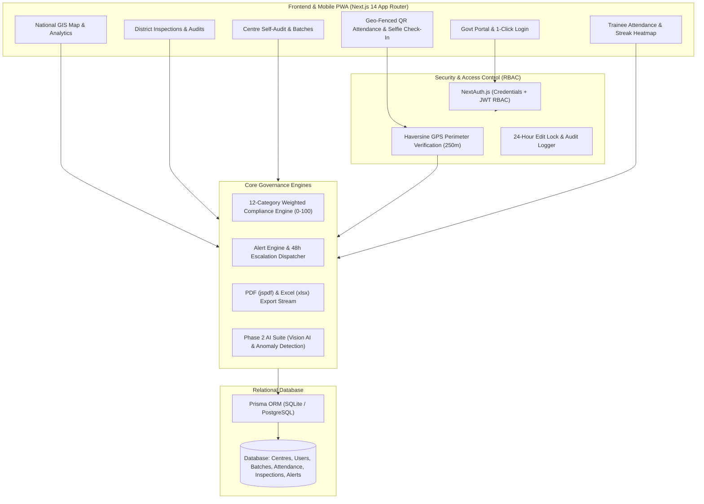
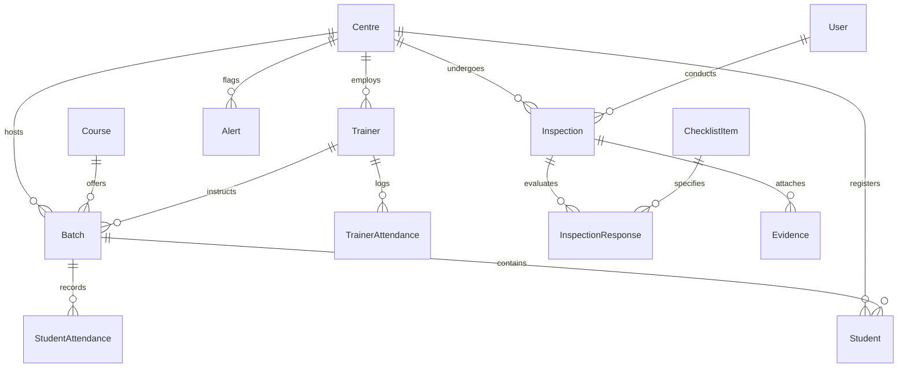

# 🏛️ TCMS – Training Centre Monitoring System
### Smart India Hackathon (SIH 2024) • Problem Statement SIH26245
> **"Training Centre Monitoring – a platform to monitor attendance and infrastructure compliance of training centres."**

[](https://nextjs.org/)
[](https://www.typescriptlang.org/)
[](https://www.prisma.io/)
[](https://tailwindcss.com/)
[](https://web.dev/progressive-web-apps/)
[](https://www.docker.com/)
[](https://opensource.org/licenses/MIT)

---

## 📌 1. Executive Summary & Problem Overview

Vocational skill development schemes across India (such as **PMKVY, DDU-GKY, NULM**) represent thousands of crores in public investment. However, ground-level monitoring faces critical operational bottlenecks:

1. **Ghost Attendance & Proxy Marking:** Manual registers and unverified biometric logs enable fraudulent attendance claims without physical presence.
2. **Infrastructure Deficits:** Computer labs lacking 1:1 terminal ratios, missing power backup, expired fire extinguishers, unhygienic washrooms, and absence of Divyangjan (wheelchair) ramps.
3. **Paper-Driven Delayed Inspections:** Traditional quarterly inspections rely on paper checklists, resulting in weeks of delay before non-compliance is penalized.
4. **Disjointed Multi-State Oversight:** State and Central authorities lack real-time GIS analytics and automated escalation when violations occur.

**TCMS (Training Centre Monitoring System)** resolves these challenges through a modern, automated governance platform featuring **Haversine geo-fenced attendance**, a **standardized 12-category weighted infrastructure inspection engine**, **automated 48-hour violation escalations**, and an **AI intelligence suite**.

---

## 🏗️ 2. System Architecture



---

## 🗄️ 3. Relational Data Model (Prisma ORM)



---

## 👥 4. User Roles & Access Matrix

The system provides 5 distinct, role-tailored dashboards and authorization tiers:

| Role | Target Portal | Core Permissions & Responsibilities |
|---|---|---|
| **Super Admin / Govt Authority** | `/admin` | Nationwide GIS Map, state/district analytics, KPI monitoring, global alert oversight, centre accreditation. |
| **District / Regional Officer** | `/officer` | Jurisdictional centre monitoring, unannounced on-site inspections, 48h escalated violation action, remediation orders. |
| **Centre Manager** | `/centre` | Single-centre administration: batch schedules, master trainers, student enrolment, monthly self-assessment checklist. |
| **Master Trainer** | `/trainer` | Geofenced student attendance marking (manual & QR), GPS selfie check-in/out, session scheduling. |
| **Student Trainee** | `/student` | Personal attendance percentage, exam eligibility (>75%), 30-day attendance heatmap, batch timetable. |

---

## ⚡ 5. 1-Click Hackathon Demo Credentials
*(Pre-seeded with realistic data across 25 centres and 60 days of history)*

> **Universal Demo Password:** `demo123`

| Role Name | Demo Email | Persona / Jurisdiction |
|---|---|---|
| 👑 **Super Admin** | `admin@tcms.gov.in` | Dr. Rajeshwar Sharma (National Authority) |
| 🏛️ **District Officer (Jaipur)** | `officer.jaipur@tcms.gov.in` | Smt. Sunita Verma, IAS (Jaipur District, Rajasthan) |
| 🏛️ **District Officer (Pune)** | `officer.pune@tcms.gov.in` | Shri Anand Kulkarni (Pune District, Maharashtra) |
| 🏢 **Centre Manager** | `manager.jaipur@tcms.gov.in` | Pradhan Mantri Kaushal Kendra (Jaipur Hub 1) |
| 👨‍🏫 **Master Trainer** | `trainer.rajesh@tcms.gov.in` | Er. Rajesh Kumar (Solar PV Installer Trade) |
| 🎓 **Student Trainee** | `student.rohit@tcms.gov.in` | Rohit Sharma (Reg: `REG-2024-00001`) |

---

## 🌟 6. Key Features & Governance Capabilities

### A. Training Centre Management & 7-Tab Profile
- Complete centre dossier: Name, official code (e.g. `TC-RJ-JPR-001`), address, GPS latitude/longitude, seating capacity, affiliation number, contact details, and exterior/interior photos.
- **7-Tab Deep Centre View:**
  1. `Overview`: Capacity, affiliation number, verified infrastructure photos.
  2. `Trainers`: Master trainers, employee IDs, qualifications, trades.
  3. `Students`: Enrolled candidates, batch allocations, contacts.
  4. `Batches`: Ongoing and completed batches, timings, assigned trainers.
  5. `Infrastructure`: Historical breakdown of the 12 compliance categories.
  6. `Attendance`: Center-level attendance metrics and audit summaries.
  7. `Alerts`: Open non-compliance alerts and unresolved violations.

### B. Student & Trainer Attendance
- **Haversine Geo-fence Check:** Validates trainer coordinates against the centre's registered GPS location (default: 250m perimeter).
- **24-Hour Edit Lock:** Attendance records cannot be edited after 24 hours without an immutable entry in the `AuditLog` table.
- **QR Code Attendance:** Live batch QR code token generation for mobile PWA self-marking.
- **Trainer Biometric Check-In/Out:** GPS timestamp capture, late arrival detection (>15 mins), and selfie capture.

### C. 12-Category Weighted Infrastructure Inspection
Standardized checklist scoring training centres from 0 to 100:
1. **Classrooms (Weight: 1.2x):** Ergonomic desks, LED lighting, natural ventilation.
2. **IT Lab & Computers (Weight: 1.5x):** 1:1 computer ratio, working peripherals, licensed OS.
3. **Power Backup (Weight: 1.2x):** Online UPS + Inverter/Generator with >=2h capacity.
4. **Drinking Water (Weight: 1.0x):** Commercial RO water purifier with TDS display.
5. **Sanitation & Toilets (Weight: 1.2x):** Separate clean washrooms for Male, Female, and PwD.
6. **Fire Safety (Weight: 1.5x):** ISI marked extinguishers, smoke alarms, emergency exits.
7. **Internet Connectivity (Weight: 1.0x):** Broadband >= 50 Mbps with Wi-Fi coverage.
8. **CCTV Surveillance (Weight: 1.2x):** 24x7 IP cameras covering entrance, labs, classrooms.
9. **Safety Signage (Weight: 0.8x):** Helpline numbers (Police, Fire, 1090, 108, 1098).
10. **Library & Toolkits (Weight: 0.8x):** Trade handbooks, manuals, digital modules.
11. **Accessibility (Weight: 1.0x):** Divyangjan wheelchair ramp (1:12) with handrails.
12. **Cleanliness & Hygiene (Weight: 1.0x):** Daily housekeeping roster and waste segregation.

### D. Automated Compliance Alert Engine & 48-Hour Escalation
- Automated triggers:
  - Batch student attendance < 75%
  - Trainer absent / repeated late arrival
  - Daily attendance not marked by scheduled session time
  - Infrastructure score < 70%
- **48-Hour Auto-Escalation:** Open alerts older than 48 hours are automatically escalated directly to the District Officer.

### E. Phase 2 AI Intelligent Suite (Feature-Flagged)
- **Vision AI Photo Inspector:** Automated verification of uploaded infrastructure photos (detects fire extinguisher pressure gauges in safe zone, 25 working desktop monitors, etc.).
- **Attendance Anomaly Detection:** Identifies proxy timestamps (e.g. 28 students marked within 1.4 seconds), GPS spoofing flags, and zero-variance streaks.
- **Predictive Risk Forecasting:** Machine learning regression predicting centres likely to fall below the 70% threshold in the next 30 days.
- **Natural Language Governance Query:** Converts natural language queries (*"Show centres in Rajasthan with attendance below 70%"*) into relational database filters.

### F. Reports & Multi-Language Readiness
- Export official ministry reports in **PDF (`jspdf` + `jspdf-autotable`)** and **Excel (`xlsx`)**.
- Defaulter list highlighting students below the 75% threshold.
- Native bilingual support (**English + Hindi**) via in-app language switcher.

---

## 🛠️ 7. Tech Stack & Dependencies

| Layer | Technologies Used |
|---|---|
| **Framework** | Next.js 14 (App Router, Server Components & Route Handlers) |
| **Language** | TypeScript 5.6 (Strict Type Checking) |
| **Styling** | Tailwind CSS 3.4, Custom Gov-Tech Design Tokens |
| **Icons & UI** | Lucide React, Custom Radix UI primitives |
| **Database & ORM** | SQLite (`file:./dev.db`) via Prisma ORM 5.22 (PostgreSQL ready) |
| **Authentication** | NextAuth.js 4.24 (Credentials Provider, JWT, RBAC) |
| **GIS & Maps** | Leaflet 1.9 & OpenStreetMap (Interactive GPS Pins) |
| **Charts & Data** | Recharts 2.13 |
| **Document Export** | jsPDF 2.5, jsPDF-AutoTable 3.8, SheetJS (XLSX) 0.18 |
| **Localization** | Custom English + Hindi i18n Dictionary Engine |
| **Containerization** | Docker, Docker Compose (Multi-stage node:20-alpine build) |

---

## 🚀 8. Getting Started (Local Setup)

### Prerequisites
- Node.js 18+ (tested on Node 20 and Node 24)
- npm or pnpm

### 1. Clone the Repository
```bash
git clone https://github.com/aditya-sharma121/-Training--Centre--Monitoring--System.git
cd -Training--Centre--Monitoring--System
```

### 2. Install Dependencies
```bash
npm install
```

### 3. Environment Configuration
Create a `.env` file from `.env.example`:
```bash
cp .env.example .env
```
Default `.env` configuration:
```env
DATABASE_URL="file:./dev.db"
NEXTAUTH_URL="http://localhost:3000"
NEXTAUTH_SECRET="tcms-super-secret-sih26245-key-2026"
NEXT_PUBLIC_APP_NAME="TCMS – Training Centre Monitoring System"
NEXT_PUBLIC_ENABLE_AI_FEATURES="true"
NEXT_PUBLIC_MAP_DEFAULT_LAT="22.5937"
NEXT_PUBLIC_MAP_DEFAULT_LNG="78.9629"
NEXT_PUBLIC_MAP_DEFAULT_ZOOM="5"
```

### 4. Initialize Database & Seed Demo Data
```bash
npx prisma db push
npm run db:seed
```
*(Creates 25 centres across 5 states, 51 trainers, 760 students, 38 batches, 60 days of attendance history, realistic inspections, and alerts).*

### 5. Run Unit Tests
```bash
npm test
```
*(Executes unit tests verifying weighted compliance calculations, mandatory check failure gates, and alert rule triggers).*

### 6. Launch Development Server
```bash
npm run dev
```
Open **[http://localhost:3000](http://localhost:3000)** in your browser.

---

## 🐳 9. Docker Deployment

Run the entire platform with a single command:
```bash
docker-compose up --build
```
Access the application at `http://localhost:3000`.

---

## ☁️ 10. Production Cloud Deployment (Vercel + Neon / Supabase)

1. Provision a PostgreSQL instance on [Neon](https://neon.tech) or [Supabase](https://supabase.com).
2. In `prisma/schema.prisma`, update the datasource provider from `sqlite` to `postgresql`:
   ```prisma
   datasource db {
     provider = "postgresql"
     url      = env("DATABASE_URL")
   }
   ```
3. Set the following environment variables in Vercel:
   - `DATABASE_URL`: Your PostgreSQL connection string.
   - `NEXTAUTH_URL`: Your live domain (e.g. `https://tcms.vercel.app`).
   - `NEXTAUTH_SECRET`: A secure 32-character random string.
   - `NEXT_PUBLIC_ENABLE_AI_FEATURES`: `true`.
4. Deploy on Vercel and run:
   ```bash
   npx prisma db push && npm run db:seed
   ```

---

## 📋 11. REST API Reference

| Method | Endpoint | Description | Auth Roles |
|---|---|---|---|
| `GET` | `/api/centres` | List all centres with filters (state, district, status, query) | Public / All |
| `POST` | `/api/centres` | Register a new training centre with coordinates | SUPER_ADMIN |
| `GET` | `/api/centres/:id` | 7-tab deep centre profile view | All Authenticated |
| `POST` | `/api/attendance/student` | Mark batch student attendance with geofence & 24h edit lock | TRAINER, MANAGER |
| `POST` | `/api/attendance/trainer` | Trainer check-in/out with GPS lat/lng and selfie snapshot | TRAINER |
| `GET` | `/api/inspections` | Fetch checklist templates & previous audits | All Authenticated |
| `POST` | `/api/inspections` | Submit 12-category inspection & auto-calculate score | OFFICER, MANAGER |
| `GET` | `/api/alerts` | List compliance alerts with 48h auto-escalation check | SUPER_ADMIN, OFFICER |
| `PATCH` | `/api/alerts` | Resolve or acknowledge an open alert with notes | OFFICER, MANAGER |
| `POST` | `/api/ai/vision-check` | Analyze photo for asset compliance (Fire/IT Lab) | All Authenticated |
| `GET` | `/api/ai/anomaly-detect` | Detect proxy attendance bursts & predict 30-day risk | SUPER_ADMIN, OFFICER |

---

## 👥 12. Authors & Hackathon Team
Built for **Smart India Hackathon 2024**  
Problem Statement **SIH26245**: *Training Centre Monitoring – a platform to monitor attendance and infrastructure compliance of training centres.*  
Repository: [aditya-sharma121/-Training--Centre--Monitoring--System](https://github.com/aditya-sharma121/-Training--Centre--Monitoring--System)
